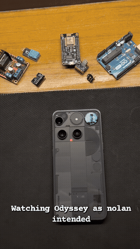
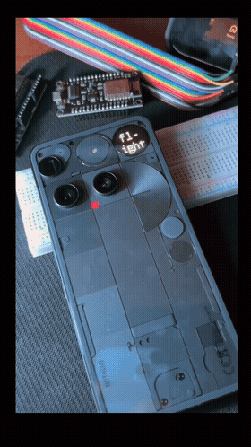

```
GLYPH ODYSSEY
video → 25×25 LED matrix  ·  on-device  ·  GNU GPLv3
```

An Android app that plays video, photos and live song lyrics on the 25×25 LED matrix of the Nothing Phone (3).

**[🌐 Visit the Live Website](https://odyssey-glyph.vercel.app/)**  
[](https://github.com/tezz-e/OdysseyGlyph/releases)

This started because I wanted to watch the Odyssey trailer on the back of my Nothing Phone as a bit. I thought it would take a few hours. It took a weekend, three rewrites, and way more thinking about pixel averaging than any reasonable person should do for a joke.

Somewhere in that process, the pipeline stopped caring what video I gave it. So I shipped it.

---

> **If you're on a Nothing Phone 1, 2, 2a, or (4a) Pro — close this tab.**
>
> Those have zone-based LED strips or lower-density matrices. The 25×25 addressable matrix is exclusive to the **Nothing Phone (3)**. This app does nothing useful on other models.

---

## Demo

<p align="center">
  
  &nbsp;&nbsp;&nbsp;&nbsp;
  
</p>

*Left: Video → Glyph Matrix pipeline running real-world video footage. Right: Live Lyrics scrolling time-synced song lyrics in real time.*

Real footage, cropped with a pinch and a pan, and still readable at 25 pixels wide. The reason is the downsampling method, covered below.

Lyrics scrolling across the matrix. Live Lyrics and Lyric Studio share the same renderer, so they look identical on the phone. Full recordings with audio are included in [`docs/`](docs/), and more discussion is on the [Nothing Community thread](https://nothing.community/d/61270-i-built-an-app-that-converts-any-video-into-a-glyph-matrix-animation).

---

## What it does

**Video → Glyph Matrix**  
Pick any video, GIF or photo from your gallery. Pinch and pan to crop a region into the 25×25 overlay with live video playback behind the frame. Trim start and end. Hit process. The app extracts frames, runs the pipeline, and plays the result on your matrix. Entirely on-device, works offline, no account needed. Results can be exported and imported as `.odyssey` preset files, with adjustable LED brightness and image duration.

**Lyric Studio**  
Load an LRC lyric file, pick a font mode, and preview frame-by-frame. Sync to audio and export as a Glyph toy. The font engine renders directly to the 25px matrix — getting text to actually read at that resolution across three different typography sizes took more iteration than I'd like to admit.

**Live Lyrics**  
Detects whatever's playing on your phone — any music app, not just Spotify — via Android's MediaSession. Fetches time-synced lyrics from LRCLib and scrolls them across the matrix in real time. No API key required, works in basically any language. If a song doesn't have lyrics available, it falls back to a built-in audio visualizer so the matrix isn't just sitting there doing nothing. That visualizer ended up being useful enough on its own that you can also run it standalone from the same widget/tile toggle.

**Quick Settings Tile & Home Screen Widget**  
Live Lyrics and the visualizer originally ran as Glyph Toys inside Nothing's carousel system. Someone pointed out that Glyph Toys have a hard 10-minute timeout — so if you're mid-album, the lights just stop. I hadn't noticed because I'd been using shorter playlists. The fix was to make them proper background services that run independently of the Toy system. You can now toggle them from a Quick Settings tile or a home screen widget, and they'll stay running as long as you want.

**Toy Manager**  
Browse, preview, and delete your saved animations. Nothing exciting, just necessary.

---

## How this is different from what already exists

If you're looking for a general-purpose Glyph animation tool, you should probably be using **Glyph Museum** (by pauwma) on the Play Store. It has 15,000+ active users, gallery/GIF import, live matrix preview, audio-reactive light shows, and a massive community library. Pauwma also maintains **GlyphMatrixEditor**, an excellent web-based frame-by-frame animation editor with onion skinning.

Glyph Odyssey is built to solve a narrower set of problems:

**1. The video processing pipeline**  
Glyph Museum imports GIFs and images. Odyssey is built specifically to crush real-world video footage — faces, cinematic shots, motion — into 25×25 pixels and have it remain legible. Box-filter downsampling, S-curve contrast stretching, unsharp masking, with live video playback running behind your gesture-crop frame.

**2. Live lyrics**  
Other apps do audio-reactive light shows (EQ bars bouncing to the beat). Odyssey does *Live Lyrics* — it reads MediaSession metadata from whatever music app you're using, fetches time-synced lyrics from LRCLib, and scrolls the actual text across the matrix in real time.

**3. Lyric studio**  
An LRC file-based authoring tool with a custom Ndot57 font engine. Dynamic per-word hyphenation and chunking to render legible text on a 25-pixel-wide constraint.

---

## The parts that were actually interesting to figure out

**Why faces are still recognizable at 25 pixels wide**  
The naive way to shrink a video frame to 25×25 is to take every Nth pixel and throw the rest away. You lose most of the source frame and it looks terrible. This app averages every pixel in each output cell's corresponding source region instead — box filter. You can actually tell who's in the video at 25 pixels wide. That difference is the whole point.

**The contrast problem**  
A flat grayscale conversion on monochrome LEDs looks like grey murk. The fix: stretch each frame's actual tonal range to 0–255 first, then apply `t*t*(3-2*t)` as an S-curve — the smoothstep function from graphics shaders. Unsharp masking runs after, and a brightness multiplier keeps dark areas truly black while highlights stay bright. Most of the hours on this project went into tuning these numbers by eye on the physical LEDs, because what looks right on a monitor doesn't on 625 LEDs.

**Mapping a pinch-zoom onto 25×25**  
Cropping the on-screen view and shrinking that is lossy, since you'd be sampling an already-downscaled image. Instead, the zoom engine's transformation matrix gets inverted (`matrix.invert()`) and each of the 25×25 grid points is mapped straight back onto the original full-resolution bitmap or video frame. No distortion, no offset, no black letterboxing.

**Lyrics in any language**  
Android ships a built-in ICU Transliterator — `Any-Latin; Latin-ASCII` — that phonetically converts any writing system to Latin characters, on-device, no network call. So when you're playing a J-pop song, the matrix doesn't try to render kanji at 25 pixels wide. It renders what the song sounds like. `夜に駆ける` becomes `yoru ni kakeru`. Falls back silently if it fails.

**Timing words that have no timestamps**  
LRC files mark the start of each lyric line. They say nothing about individual words, and LRCLib rarely has word-level sync. The app estimates per-word timing by weighting each word by character count — longer words get more time — with extra hold after punctuation since those have natural spoken pauses. It's a heuristic, and the tuning around it was fiddly: the global offset, and what to do with long words that don't fit in 25 pixels (split onto two lines, or scroll them). I went back and forth on both before it felt right.

**Why live lyrics drift if you don't do something about it**  
Spotify and YouTube Music fire a PlaybackState callback when something changes — play, pause, skip. They don't broadcast continuous position. So if you extrapolate position from the last known state, you slowly fall behind mid-song. Fix: poll `MediaController` every 500ms for a fresh position read. Boring solution, lyrics stay locked.

**The crash that wasn't a graphics bug**  
Rendering a still photo crashed the app instantly, while video worked fine. Obvious suspect: something about images. A 48MP photo blowing up memory, a hardware-backed bitmap that couldn't be sampled, the decoder itself. I spent a while changing downsamplers and decoder settings, none of which did anything. The actual cause was a few lines away from the button: photos have no duration, so the trim `RangeSlider` is disabled for them, which empties its `values` list, and the Render handler then read `values[1]` and threw an `IndexOutOfBoundsException` on the main thread before touching a single pixel. One bounds check fixed it. I only found it once I got the real stack trace instead of guessing.

**Small SDK and Android things that bit me**  
`GlyphMatrixManager.unInit()` throws a fatal `IllegalArgumentException` ("Service not registered") if the service had already disconnected, so teardown has to be wrapped in a try-catch. On Android 13+, the background toy player's foreground service silently fails unless the app requests the `POST_NOTIFICATIONS` runtime permission. And for the background service to stream animations without lag, I ended up designing a small binary format (`.odyssey`): a header with slot index, frame count and FPS, followed by raw 8-bit monochrome pixels for each frame.

---

## Install

> **⚠️ Normal sideload is temporarily blocked by Play Protect — ADB required for now.**  
> See the section below for the full explanation and step-by-step instructions.

**Step 1 — Download the APK**

Go to the [latest release](https://github.com/tezz-e/OdysseyGlyph/releases) and download `app-release.apk` to your computer (not your phone).

**Step 2 — Set up ADB on your computer**

ADB (Android Debug Bridge) is a free official Google tool that lets your computer talk directly to your phone. You only need to do this once.

- Go to [developer.android.com/tools/releases/platform-tools](https://developer.android.com/tools/releases/platform-tools)
- Download Platform Tools for your OS (Windows / Mac / Linux)
- Extract the zip anywhere — e.g. `C:\platform-tools` on Windows
- Move `app-release.apk` into that same folder so it's easy to find

**Step 3 — Enable USB Debugging on your phone**

USB Debugging lets ADB communicate with your device. It's a standard developer setting, not anything sketchy.

1. Open **Settings → About Phone**
2. Find **Build Number** and tap it **7 times** — you'll see "You are now a developer"
3. Go back to **Settings → System → Developer Options**
4. Enable **USB Debugging**

**Step 4 — Connect and install**

Plug your phone into your computer with a USB cable. Your phone will show a prompt asking to trust this computer — tap **Allow**.

Then open a terminal (Command Prompt on Windows, Terminal on Mac/Linux), navigate to your platform-tools folder, and run:

```bash
adb install app-release.apk
```

You'll see `Success` when it's done. The app will appear in your app drawer.

**Step 5 — Grant permissions on first launch**

Open Glyph Odyssey. Grant media access when prompted. For Live Lyrics, the app will ask you to enable **Notification Access** in Android settings — follow the prompt, it takes you there directly.

---

## Why ADB and not just download and tap?

Google Play Protect is automatically hard-blocking the APK at install — not because it's malicious, but because of a blanket policy: any app sideloaded from the internet that declares the `NOTIFICATION_LISTENER` permission gets blocked, full stop, regardless of what it actually does with it. That permission is heavily abused by spyware, so Google nukes anything sideloaded that uses it.

This app needs `NOTIFICATION_LISTENER` for Live Lyrics — to read the current track title and artist from whatever music app you're using. That's the entire extent of what it does with the permission. **0 of 66 security vendors on VirusTotal flag it.** A Play Protect appeal has been submitted. If it's approved, tapping the APK to install will work again and you won't need ADB.

ADB bypasses Play Protect entirely because it's a direct developer channel — your computer talks to the phone directly, Play Protect never sees the install.

---

## Security & Trust

**How do I know the APK is safe?**  
Every release is built transparently by [GitHub Actions](https://github.com/tezz-e/OdysseyGlyph/actions) from the open-source code in this repo — not on a personal machine. Build logs are public. The same workflow submits the APK to the VirusTotal API and publishes the report with the release automatically, along with the SHA-256 hash, so the scan result isn't something I get to hand-pick.

**Notification access is a scary permission**  
Fair. Live Lyrics needs it to read track metadata — title, artist, playback position. That's it. Nothing is logged, stored, or transmitted except the LRCLib lyrics fetch which only sends song title and artist. If you'd rather not grant it, skip Live Lyrics — everything else works without it.

---

## FAQ

**Does it drain battery?**  
Video processing is CPU-heavy but finishes in seconds. The Live Lyrics service runs a MediaSession poll and a ~12fps render loop. Roughly equivalent to a music visualizer widget.

**Will this get maintained?**  
I use it myself so when something bothers me enough I'll fix it. No roadmap, no promises.

---

## Build from source

```bash
git clone https://github.com/tezz-e/OdysseyGlyph.git
```

Open in Android Studio → sync Gradle → run to a connected Nothing Phone. The `glyph-matrix-sdk-2.0.aar` is already in `android/app/libs/`.

---

## License

GNU GPLv3. Not affiliated with Nothing Technology Limited.
