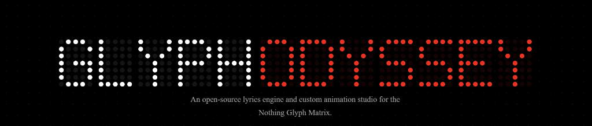
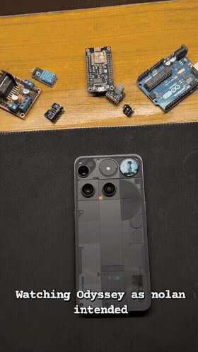
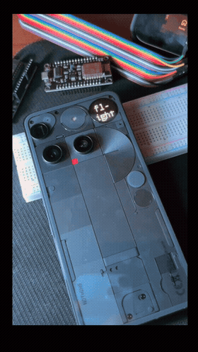

<p align="center">
  <a href="https://odyssey-glyph.vercel.app/">
    
  </a>
</p>

```
GLYPH ODYSSEY
video → 25×25 LED matrix  ·  on-device  ·  GNU GPLv3
```

An Android app that plays video, photos, live song lyrics, quick status signals, and audio visualizers on the 25×25 LED matrix of the Nothing Phone (3).

**[🌐 Visit the Live Website](https://odyssey-glyph.vercel.app/)** · **[🔒 Privacy Policy](https://odyssey-glyph.vercel.app/privacy)**  
[](https://github.com/tezz-e/OdysseyGlyph/releases)

This started because I wanted to watch the Odyssey trailer on the back of my Nothing Phone as a bit. I thought it would take a few hours. It took a weekend, three rewrites, and way more thinking about pixel averaging than any reasonable person should do for a joke.

Somewhere in that process, the pipeline stopped caring what video I gave it. So I shipped it.

---

> **If you're on a Nothing Phone 1, 2, 2a, or (4a) Pro — close this tab.**
>
> Those have zone-based LED strips or lower-density matrices. The 25×25 addressable matrix is exclusive to the **Nothing Phone (3)**. This app does nothing useful on other models.

---

## Demo

<p align="center">
  
  &nbsp;&nbsp;&nbsp;&nbsp;
  
</p>

*Left: Video → Glyph Matrix pipeline running real-world video footage. Right: Live Lyrics scrolling time-synced song lyrics in real time.*

Real footage, cropped with a pinch and a pan, and still readable at 25 pixels wide. The reason is the downsampling method, covered below.

Lyrics scrolling across the matrix. Live Lyrics and Quick Signal share the same custom font engine, so typography stays crisp and consistent on physical LEDs. More clips of it running on actual hardware are on my Instagram: [@tezze301](https://www.instagram.com/tezze301/), with full recordings in [`docs/`](docs/) and discussion on the [Nothing Community thread](https://nothing.community/d/61270-i-built-an-app-that-converts-any-video-into-a-glyph-matrix-animation).

---

## What it does

**Video → Glyph Matrix**  
Pick any video, GIF or photo from your gallery. Pinch and pan to crop a region into the 25×25 overlay with live video playback behind the frame. Trim start and end. Hit process. The app uses a hardware-accelerated MediaCodec pipeline with zero-copy Y-luminance extraction to crunch frames directly into the 25×25 matrix in seconds. Entirely on-device, works offline, no account needed. Results can be exported and imported as `.odyssey` preset files, with adjustable LED brightness and image duration.

**Quick Signal**  
Broadcast instant status messages and symbols on the rear 25×25 matrix without unlocking your phone or playing audio. Choose from pre-made presets (WAIT, BRB, STOP, TAXI, symbols) or type your own custom text. Switch between three typography styles: Pixel (clean 1-pixel glyphs), Smooth (soft anti-aliased edges), and Blocky (thick high-contrast strokes for direct sunlight).

**Live Lyrics & Offline Caching**  
Detects whatever is playing on your phone (any music app via Android MediaSession), matches the track with smart consensus scoring to prevent mismatches on live or remastered cuts, and streams synchronized lyrics across the matrix in real time. Synced lyrics are cached in a local SQLite database so repeat plays work completely offline with zero network requests. If a song has no lyrics available, it automatically switches to a built-in audio visualizer.

**Standalone Audio Visualizers**  
Run real-time reactive light shows independently of lyrics: frequency bars bouncing to bass and treble, expanding concentric pulses, or an animated oscilloscope reticle.

**Quick Settings Tile & Home Screen Widget**  
Live Lyrics, Quick Signal, and the visualizers run as independent background services that bypass Nothing's 10-minute toy timeout. Toggle them on the fly from a Quick Settings tile or a home screen widget, and they will stay running as long as you want.

**Hardware Bento Console & Dark Glass UI**  
A visual design matching Nothing OS principles. Liquid glass segmented controls with tactile spring physics, custom Ndot overflow menu, interactive spotlight tour, and zero external trackers.

**Toy Manager**  
Browse, preview, and delete your saved animations. Nothing exciting, just necessary.

---

## How this is different from what already exists

If you're looking for a general-purpose Glyph animation tool, you should probably be using **Glyph Museum** (by pauwma) on the Play Store. It has 15,000+ active users, gallery/GIF import, live matrix preview, audio-reactive light shows, and a massive community library. Pauwma also maintains **GlyphMatrixEditor**, an excellent web-based frame-by-frame animation editor with onion skinning.

Glyph Odyssey is built to solve a narrower set of problems:

**1. The hardware video processing pipeline**  
Glyph Museum imports GIFs and images. Odyssey is built specifically to crush real-world video footage (faces, cinematic shots, rapid motion) into 25×25 pixels and keep it legible. Instead of decoding to RGB bitmaps and throwing away pixels, Odyssey uses a hardware MediaCodec pipeline that extracts the raw Y-plane luminance channel directly, followed by box-filter downsampling, S-curve contrast stretching, and unsharp masking.

**2. Live lyrics with consensus matching**  
Other apps do audio-reactive light shows (EQ bars bouncing to the beat). Odyssey does *Live Lyrics*: it reads MediaSession metadata from whatever music app you're using, fetches time-synced lyrics from LRCLib, scores candidate tracks for consensus, caches them offline in SQLite, and scrolls the actual text across the matrix in real time.

**3. Quick Signal & Standalone Visualizers**  
Direct rear-matrix messaging with custom 25×25 typography engines, plus frequency and pulse visualizers that run without timeouts as background services.

---

## The parts that were actually interesting to figure out

**Why faces are still recognizable at 25 pixels wide**  
The naive way to shrink a video frame to 25×25 is to take every Nth pixel and throw the rest away. You lose most of the source frame and it looks terrible. This app averages every pixel in each output cell's corresponding source region instead — box filter. You can actually tell who's in the video at 25 pixels wide. That difference is the whole point.

**The contrast problem**  
A flat grayscale conversion on monochrome LEDs looks like grey murk. The fix: stretch each frame's actual tonal range to 0–255 first, then apply `t*t*(3-2*t)` as an S-curve — the smoothstep function from graphics shaders. Unsharp masking runs after, and a brightness multiplier keeps dark areas truly black while highlights stay bright. Most of the hours on this project went into tuning these numbers by eye on the physical LEDs, because what looks right on a monitor doesn't on 625 LEDs.

**Mapping a pinch-zoom onto 25×25**  
Cropping the on-screen view and shrinking that is lossy, since you'd be sampling an already-downscaled image. Instead, the zoom engine's transformation matrix gets inverted (`matrix.invert()`) and each of the 25×25 grid points is mapped straight back onto the original full-resolution bitmap or video frame. No distortion, no offset, no black letterboxing.

**Lyrics in any language**  
Android ships a built-in ICU Transliterator — `Any-Latin; Latin-ASCII` — that phonetically converts any writing system to Latin characters, on-device, no network call. So when you're playing a J-pop song, the matrix doesn't try to render kanji at 25 pixels wide. It renders what the song sounds like. `夜に駆ける` becomes `yoru ni kakeru`. Falls back silently if it fails.

**Timing words that have no timestamps**  
LRC files mark the start of each lyric line. They say nothing about individual words, and LRCLib rarely has word-level sync. The app estimates per-word timing by weighting each word by character count — longer words get more time — with extra hold after punctuation since those have natural spoken pauses. It's a heuristic, and the tuning around it was fiddly: the global offset, and what to do with long words that don't fit in 25 pixels (split onto two lines, or scroll them). I went back and forth on both before it felt right.

**Why live lyrics drift if you don't do something about it**  
Spotify and YouTube Music fire a PlaybackState callback when something changes — play, pause, skip. They don't broadcast continuous position. So if you extrapolate position from the last known state, you slowly fall behind mid-song. Fix: poll `MediaController` every 500ms for a fresh position read. Boring solution, lyrics stay locked.

**Extracting luminance straight from hardware video buffers (MediaCodec YUV)**  
The original video pipeline used Android's `MediaMetadataRetriever` to extract frames as full-resolution ARGB bitmaps, then iterated through RGB channels to calculate perceived brightness. Decoding a 1080p frame just to throw away 99.9% of the pixels burned CPU, created garbage collection pauses, and took 20+ seconds for a 5-second clip. In v2.1, the pipeline runs on `MediaCodec` and requests `COLOR_FormatYUV420Flexible`. In YUV color formats, the Y channel is already the raw monochrome luminance (grayscale). The decoder maps the Y-plane byte buffer directly into scratch memory and averages rows with parallel bitwise downsampling. Color conversion and bitmap allocations drop to zero, and a 10-second clip finishes processing in under two seconds.

**Why typography is hard on 25 pixels and how Quick Signal handles it**  
Rendering text on a 25×25 grid means each letter has about 5 to 7 pixels of height. Standard Android fonts look like blurry mush when downscaled to that size because anti-aliasing bleeds across adjacent physical LEDs. Quick Signal reuses the `GlyphFontEngine` built for Live Lyrics, but adds three distinct rendering modes. Pixel mode snaps strictly to integer LED coordinates for maximum sharpness. Smooth mode uses fractional horizontal offsets with linear interpolation for fluid marquee scrolling. Blocky mode doubles stroke weights so short words like WAIT or BRB punch through bright daylight. For symbols (reticles, arrows, icons), we skipped vector rasterization entirely and drew dedicated 25×25 bitmasks by hand.

**Consensus matching and offline lyric caching**  
Early versions of Live Lyrics queried LRCLib with whatever title and artist string MediaSession gave us. If you played a live album, deluxe edition, or remaster, the extra title tags (like '[Live at Wembley - 2011 Remaster]') caused exact lookups to fail or return the wrong studio cut with drifting timestamps. The new matcher normalizes strings, strips parenthetical noise, queries candidate variants, and runs a scoring matrix across title similarity, artist match, and song duration tolerance (within 2 seconds). If there is a high-confidence consensus, it locks instantly. If two distinct versions clash, it prompts with a track picker instead of guessing. Once lyrics are fetched, the parsed lines are stored in a local SQLite database, so the next time that song plays, it loads instantly offline without hitting the network.

**Cutting the binary size in half (5.66 MB to 2.94 MB)**  
The v2.0 release APK was over 5.6 MB. An inspection of the APK bundle showed that over 2 MB came from an unused Japanese font (`dotgothic16.ttf`) that was left over from an early typography experiment, plus unminified SDK classes. For v2.1, we purged the unused font assets, enabled R8 code shrinking and resource shrinking, and wrote ProGuard keep rules for ZoomLayout and the Nothing SDK reflection hooks. The release APK dropped from 5.66 MB to 2.94 MB (and the AAB to 2.95 MB), cutting download size by 48% with zero impact on functionality.

**The crash that wasn't a graphics bug**  
Rendering a still photo crashed the app instantly, while video worked fine. Obvious suspect: something about images. A 48MP photo blowing up memory, a hardware-backed bitmap that couldn't be sampled, the decoder itself. I spent a while changing downsamplers and decoder settings, none of which did anything. The actual cause was a few lines away from the button: photos have no duration, so the trim `RangeSlider` is disabled for them, which empties its `values` list, and the Render handler then read `values[1]` and threw an `IndexOutOfBoundsException` on the main thread before touching a single pixel. One bounds check fixed it. I only found it once I got the real stack trace instead of guessing.

**Small SDK and Android things that bit me**  
`GlyphMatrixManager.unInit()` throws a fatal `IllegalArgumentException` ("Service not registered") if the service had already disconnected, so teardown has to be wrapped in a try-catch. On Android 13+, the background toy player's foreground service silently fails unless the app requests the `POST_NOTIFICATIONS` runtime permission. And for the background service to stream animations without lag, I ended up designing a small binary format (`.odyssey`): a header with slot index, frame count and FPS, followed by raw 8-bit monochrome pixels for each frame.

---

## Install

> **⚠️ Normal sideload is temporarily blocked by Play Protect — ADB required for now.**  
> See the section below for the full explanation and step-by-step instructions.

**Step 1 — Download the APK**

Go to the [latest release](https://github.com/tezz-e/OdysseyGlyph/releases) and download `app-release.apk` to your computer (not your phone).

**Step 2 — Set up ADB on your computer**

ADB (Android Debug Bridge) is a free official Google tool that lets your computer talk directly to your phone. You only need to do this once.

- Go to [developer.android.com/tools/releases/platform-tools](https://developer.android.com/tools/releases/platform-tools)
- Download Platform Tools for your OS (Windows / Mac / Linux)
- Extract the zip anywhere — e.g. `C:\platform-tools` on Windows
- Move `app-release.apk` into that same folder so it's easy to find

**Step 3 — Enable USB Debugging on your phone**

USB Debugging lets ADB communicate with your device. It's a standard developer setting, not anything sketchy.

1. Open **Settings → About Phone**
2. Find **Build Number** and tap it **7 times** — you'll see "You are now a developer"
3. Go back to **Settings → System → Developer Options**
4. Enable **USB Debugging**

**Step 4 — Connect and install**

Plug your phone into your computer with a USB cable. Your phone will show a prompt asking to trust this computer — tap **Allow**.

Then open a terminal (Command Prompt on Windows, Terminal on Mac/Linux), navigate to your platform-tools folder, and run:

```bash
adb install app-release.apk
```

You'll see `Success` when it's done. The app will appear in your app drawer.

**Step 5 — Grant permissions on first launch**

Open Glyph Odyssey. Grant media access when prompted. For Live Lyrics, the app will ask you to enable **Notification Access** in Android settings — follow the prompt, it takes you there directly.

---

## Why ADB and not just download and tap?

Google Play Protect is automatically hard-blocking the APK at install — not because it's malicious, but because of a blanket policy: any app sideloaded from the internet that declares the `NOTIFICATION_LISTENER` permission gets blocked, full stop, regardless of what it actually does with it. That permission is heavily abused by spyware, so Google nukes anything sideloaded that uses it.

This app needs `NOTIFICATION_LISTENER` for Live Lyrics — to read the current track title and artist from whatever music app you're using. That's the entire extent of what it does with the permission. **0 of 66 security vendors on VirusTotal flag it.** A Play Protect appeal has been submitted. If it's approved, tapping the APK to install will work again and you won't need ADB.

ADB bypasses Play Protect entirely because it's a direct developer channel — your computer talks to the phone directly, Play Protect never sees the install.

---

## Security & Trust

**How do I know the APK is safe?**  
Every release is built transparently by [GitHub Actions](https://github.com/tezz-e/OdysseyGlyph/actions) from the open-source code in this repo — not on a personal machine. Build logs are public. The same workflow submits the APK to the VirusTotal API and publishes the report with the release automatically, along with the SHA-256 hash, so the scan result isn't something I get to hand-pick.

**Notification access is a scary permission**  
Fair. Live Lyrics needs it to read track metadata (title, artist, playback position). That's it. Nothing is logged, stored, or transmitted except the LRCLib lyrics fetch which only sends song title and artist. If you'd rather not grant it, skip Live Lyrics (everything else works without it). Full details are in our [Privacy Policy](https://odyssey-glyph.vercel.app/privacy).

---

## FAQ

**Does it drain battery?**  
Video processing is CPU-heavy but finishes in seconds. The Live Lyrics service runs a MediaSession poll and a ~12fps render loop. Roughly equivalent to a music visualizer widget.

**Will this get maintained?**  
I use it myself so when something bothers me enough I'll fix it. No roadmap, no promises.

---

## Build from source

```bash
git clone https://github.com/tezz-e/OdysseyGlyph.git
```

Open in Android Studio → sync Gradle → run to a connected Nothing Phone. The `glyph-matrix-sdk-2.0.aar` is already in `android/app/libs/`.

---

## License

GNU GPLv3. Not affiliated with Nothing Technology Limited.
